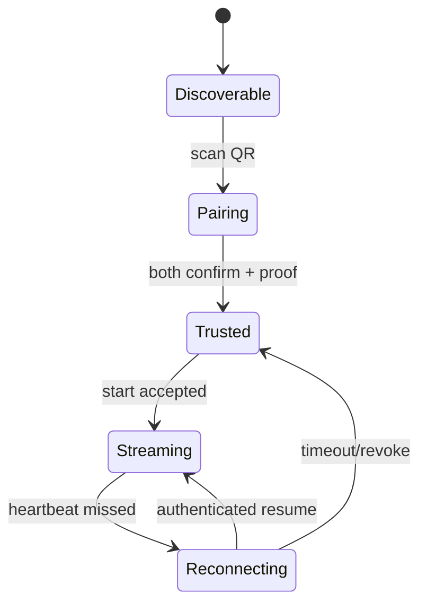

# Communication Protocol

## Objective

Provide a versioned, low-latency, authenticated local transport over Wi-Fi and ADB USB.

## Handshake and trust

QR pairs an ephemeral host public key fingerprint, one-time pairing secret, expiry (five minutes), and protocol range. Both endpoints display the phone/PC name and require confirmation. The completed handshake derives a device-specific secret using ECDH; private keys reside in Android Keystore and Windows DPAPI-backed credential storage. Trusted peers reconnect using a fresh ECDH session and signed nonces. Revocation erases the peer key and invalidates sessions.

## Media, heartbeat, and recovery

H.264 Annex-B access units carry a 90 kHz PTS; Opus uses 48 kHz sample time. The Host retains a 60–120 ms bounded jitter buffer and asks the phone for a keyframe after loss. `HEARTBEAT` every second reports monotonic time, battery, RSSI, encode/decode queues, and loss estimate. Three missed heartbeats transition to reconnect. Encoder adaptation uses host feedback: lower bitrate first, then FPS, then resolution; it never changes profiles without surfacing state to the UI.

## Security and compression

TLS 1.3 protects Wi-Fi; ADB supplies its authenticated USB transport and the application still performs peer authentication. Pairing secrets are single-use, random 256-bit values. Sequence windows and nonce-bound request signatures prevent replay; timestamps are advisory only. Control CBOR is not compressed. Media is already compressed and must not be recompressed. Certificate pinning applies to the QR-advertised ephemeral host identity, not a public CA.

## Alternatives and pitfalls

WebRTC offers NAT traversal and congestion control but is unnecessary for the LAN-only MVP. UDP/RTP is a later option after packet-loss testing. Do not send codec configuration only once without replaying it on reconnect/keyframes; do not assume wall clocks are synchronized; never trust mDNS data as authentication. Complexity is high; dependencies are TLS, CBOR, mDNS, ADB, Android Keystore, and DPAPI.
