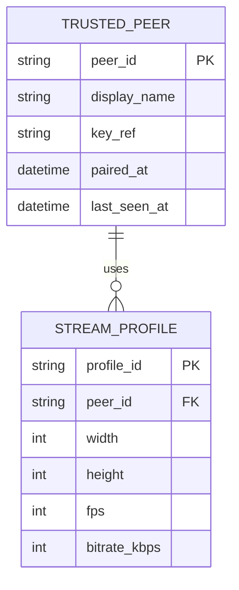

# Data Storage

## Objective

Persist the smallest possible local configuration set; no central database or cloud account exists.

## Local schema

Android uses encrypted DataStore for non-secret settings and Android Keystore aliases for private keys. Windows uses a versioned SQLite configuration store under `%LocalAppData%` with SQLCipher only if a platform review determines metadata sensitivity justifies its operational cost; device secrets are DPAPI-protected blobs, never SQLite plaintext. Tables: `trusted_peer`, `stream_profile`, `app_setting`, `migration_history`. `trusted_peer.peer_id` and `(peer_id, last_used_at)` are indexed. Foreign keys are enforced; peer deletion cascades profiles but first erases key material.

Migrations are forward-only, idempotent, transactional, and tested from each supported previous release. Backups are not automatic because pairing metadata is security-sensitive; the user can re-pair. Data retention: diagnostic logs 14 days or 50 MiB, whichever comes first; media is never stored.

Alternatives: JSON is simpler but is harder to migrate safely; a cloud database conflicts with no-login/no-cost goals. Complexity is low-medium; dependencies are DataStore, SQLite, and OS key stores.
