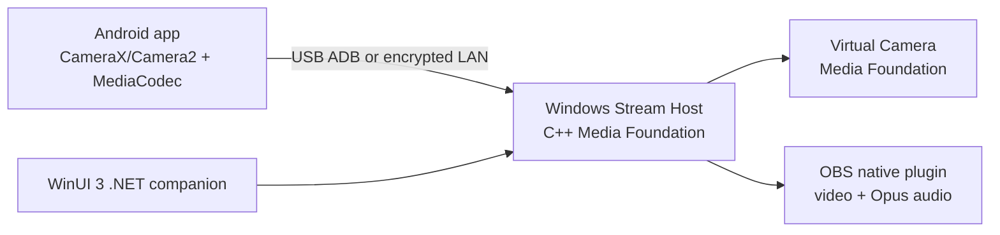

# CamLink Local

CamLink Local is a privacy-first Android-to-Windows webcam system. It streams an Android camera and microphone over USB (ADB) or an encrypted same-LAN connection, exposes a Windows virtual camera, and provides an OBS native plugin. It has no accounts, backend, analytics, or recurring operating cost.

## Status and v1 scope

This repository is the production architecture and delivery blueprint for a solo, one-month MVP. v1 includes Android 10+, Windows 10 22H2/11 x64, 480p/720p/1080p at 15/30/60 FPS where hardware permits, front/rear cameras, H.264 video, Opus audio delivered to OBS, QR pairing, mDNS discovery with manual IP fallback, encrypted Wi-Fi, ADB USB, reconnect, and virtual webcam output. Virtual microphone, 1440p/4K, recording, remote access, AI effects, and ARM64 Windows are post-v1.

## Architecture



See [PRD.md](PRD.md), [SYSTEM_ARCHITECTURE.md](SYSTEM_ARCHITECTURE.md), and [TECHNICAL_ARCHITECTURE.md](TECHNICAL_ARCHITECTURE.md).

## Repository layout

```text
android/       Kotlin Android application
windows/       WinUI companion, native host, virtual camera, OBS plugin
shared/        Versioned protocol schemas and test vectors
docs/adr/      Architecture decision records
tools/         Signing, packaging, diagnostics scripts
```

## Local setup

Prerequisites: Android Studio (JDK 21, Android SDK 35), Visual Studio 2022/Build Tools with Desktop C++ and Windows SDK, .NET 10 SDK, OBS 31 development headers, and Android platform-tools. Run the Android app on a physical Android 10+ device; enable USB debugging only for USB transport.

```powershell
./gradlew :android:app:assembleDebug
dotnet build windows/CamLink.Desktop/CamLink.Desktop.csproj
cmake --preset windows-x64-debug
cmake --build --preset windows-x64-debug
```

## Configuration

No environment variables are required for normal local operation. Build and release secrets are documented in [CONFIGURATION_REFERENCE.md](CONFIGURATION_REFERENCE.md). Docker is deliberately not used in the runtime product; it may be used only by CI tooling.

## Build, test, and troubleshooting

Run the focused commands in [DEVELOPER_GUIDE.md](DEVELOPER_GUIDE.md) and the acceptance matrix in [TESTING.md](TESTING.md). For pairing or firewall failures, use the diagnostic bundle described in [USER_MANUAL.md](USER_MANUAL.md). Never share pairing keys or diagnostics without reviewing them.

## License and contribution

Licensed under Apache-2.0. Contributions follow [CONTRIBUTING.md](CONTRIBUTING.md), [CODING_STANDARDS.md](CODING_STANDARDS.md), and [GIT_WORKFLOW.md](GIT_WORKFLOW.md).
