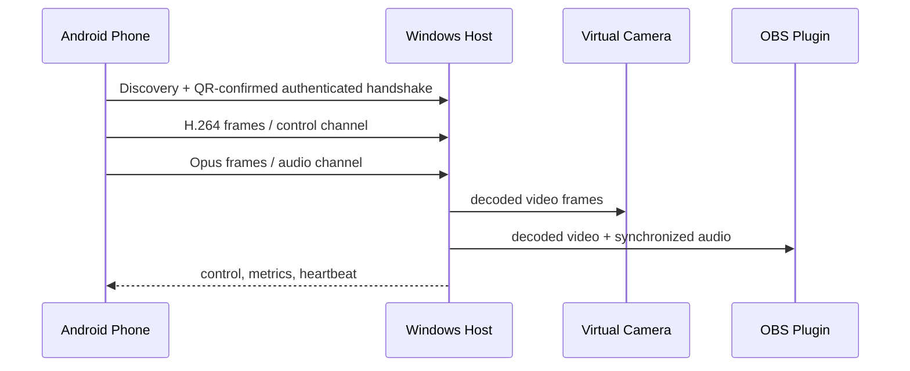

# System Architecture

## Objective

Define a local, fault-tolerant media system with a narrow trust boundary and independently releasable Android and Windows components.

## Components and data flow

Android owns capture, encoder configuration, device UX, and trusted-peer keys. The Windows Host owns transport termination, jitter/reorder buffers, decode, status, and IPC. The Media Foundation virtual camera is a small native source that reads decoded frames via shared memory/IPC. The OBS plugin consumes Host IPC and is independent of the companion UI. The WinUI app owns installation guidance, pairing, preferences, and diagnostics.

## Deployment, availability, and fault tolerance

All runtime traffic stays on the local machine or LAN. Wi-Fi uses mDNS `_camlink._tcp.local`; manual IP is a supported recovery path. USB forwards the same protocol through `adb reverse`/`adb forward`, avoiding a second media design. There is no server tier or database. A host crash restarts through a per-user background helper; virtual camera falls back to a static disconnected frame. Reconnect uses a bounded 10-minute exponential schedule (1–30 seconds) and retains no media.

## Scalability and trade-offs

The v1 scalability unit is one active stream per Windows Host; multiple paired phones are stored but only one can publish. This intentionally limits CPU, driver complexity, and support burden. WebRTC was rejected for v1 because same-LAN plus USB does not require NAT traversal and its stack increases binary and debugging complexity. Raw UDP media is rejected because reliable control, encryption, and congestion behavior would need to be rebuilt. QUIC/TLS with independent streams is the post-MVP transport path; v1 uses TLS-over-TCP with adaptive encoder control for predictable implementation.

## Operational standards

Use semantic protocol versions, structured events, monotonic clocks, bounded queues, cancellation on lifecycle loss, and health endpoints over local IPC. Follow Microsoft virtual-camera and Android foreground-service requirements; do not claim compatibility for applications that reject virtual devices.
