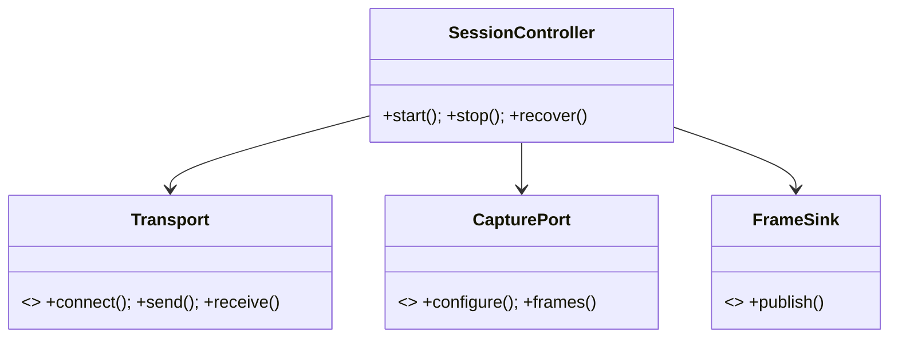

# Technical Architecture

## Objective

Apply clean boundaries so platform APIs, codecs, transport, and UI can change without rewriting domain behavior.

## Design

Android uses Kotlin, Coroutines/Flow, CameraX for lifecycle and Camera2 interop for supported manual controls, `MediaCodec` H.264 encoding, and `AudioRecord` plus Opus. Presentation is MVVM; domain use cases (`PairPeer`, `StartSession`, `UpdateCaptureProfile`, `RecoverSession`) depend on interfaces, not Android APIs. Hilt provides scoped implementations. Repositories persist only trusted-peer metadata with Android Keystore-protected keys.

Windows uses WinUI 3/.NET 10 for presentation and orchestration, a C++20 native Host for Media Foundation and low-latency media, a C++ Media Foundation virtual camera, and C++ OBS plugin. The UI calls a versioned local named-pipe API; it never touches decoded frame buffers. Native contracts use explicit ownership and cancellation.

## Layers and modules

| Layer | Responsibilities | Must not depend on |
|---|---|---|
| Presentation | MVVM state, commands, accessibility | codecs, sockets |
| Domain | session state machine, policies, contracts | platform frameworks |
| Data/platform | CameraX, key store, preferences, IPC | UI types |
| Streaming | encoder/decoder, jitter, A/V clock | UI and persistence |
| Driver | virtual camera registration and sample delivery | pairing/network policy |

## Decisions and guidance

Media Foundation is chosen over DirectShow for the virtual camera because it is the modern Windows path; DirectShow is not added unless a compatibility test proves a hard requirement. FFmpeg is excluded from v1 to reduce licensing, CVE, binary, and support surface; platform codecs are preferred. A virtual audio driver is not a v1 dependency; OBS receives audio directly. Common pitfalls: letting UI own a session, unbounded channels, codec callbacks blocking, storing keys in preferences, and coupling driver builds to the desktop UI.

Effort/complexity: Android medium-high; Host and virtual camera high; OBS medium. See [docs/adr](docs/adr) for binding decisions.
